<p align="center">
  
</p>

<h1 align="center">Recensa</h1>

<p align="center">
  <strong>See what your agents actually did.</strong><br>
  A self-hosted viewer for your Claude Code session transcripts — read, search,
  replay, and audit every session you have ever run. Your transcripts stay on your
  machine; nothing is uploaded anywhere.
</p>

<p align="center">
  <a href="./LICENSE"></a>
  = 22">
  
  <a href="https://github.com/S40911120/recensa/actions/workflows/ci.yml"></a>
  <a href="https://hub.docker.com/r/s40911120/recensa"></a>
</p>

<p align="center">
  <a href="#quick-start">Quick start</a> ·
  <a href="#a-tour">Tour</a> ·
  <a href="#why-recensa">Why</a> ·
  <a href="#themes">Themes</a> ·
  <a href="#security-and-your-data">Security</a> ·
  <a href="#architecture">Architecture</a> ·
  <a href="#contributing">Contributing</a>
</p>

Every Claude Code session you run is written to disk as raw JSONL under
`~/.claude/projects/` — the full conversation, every tool call, the model's thinking,
every subagent it spawned. Then it just sits there, unreadable. Want to know how you
fixed that bug last month? What that 40-minute agent run actually changed? Which of
your prompts sent it down a dead end? Good luck grepping.

Recensa indexes those transcripts into a local SQLite database and serves a
three-pane reader at `http://localhost:7788`. Reading never modifies your
transcripts, and the index is a disposable cache you can rebuild at any time.

<p align="center">
  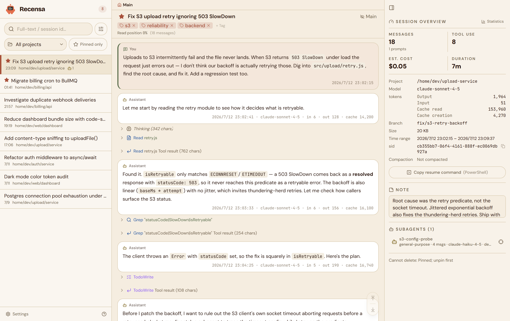
</p>

## Quick start

You need Docker (Docker Desktop on Windows/macOS, Docker Engine on Linux) and a
`~/.claude` directory with some sessions in it.

**Try it** — run the prebuilt image straight from Docker Hub:

```bash
# macOS / Linux
docker run -d --name recensa -p 127.0.0.1:7788:7788 \
  -v "$HOME/.claude:/data/claude" \
  -v recensa-data:/app/backend/data \
  -e RECENSA_PROJECTS_DIR=/data/claude/projects \
  s40911120/recensa
```

```powershell
# Windows — use PowerShell, not Git Bash (MSYS rewrites the /data/... paths)
docker run -d --name recensa -p 127.0.0.1:7788:7788 `
  -v "$env:USERPROFILE\.claude:/data/claude" `
  -v recensa-data:/app/backend/data `
  -e RECENSA_PROJECTS_DIR=/data/claude/projects `
  s40911120/recensa
```

**Or run it from source** with Compose:

```bash
git clone https://github.com/S40911120/recensa.git && cd recensa
cp .env.example .env             # set CLAUDE_HOME to your .claude path
docker compose up -d --build
```

Then open **http://localhost:7788**. The first index runs in a background worker and
can take minutes to tens of minutes depending on how many sessions you have — the
UI is usable while it runs, and progress shows in a floating pill in the corner.

## A tour

**Search all of it, not the last five.** Claude Code's resume picker shows a handful
of recent sessions. Recensa's full-text search (SQLite FTS5, CJK-aware) covers every
session you have ever run — "how did I fix that S3 retry bug?" is one query away.

<p align="center">
  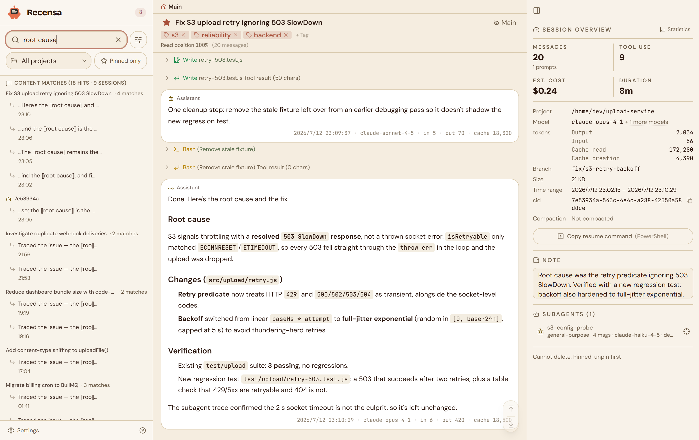
</p>

**Follow the conversation, not the noise.** One session can hold thousands of tool
calls. God-view folds tools, thinking, and system noise into landmark rows you can
expand on demand. Async tool results are paired back to their call with a shared
colored rail, so a `tool_result` landing twelve messages later still reads as one
step.

<p align="center">
  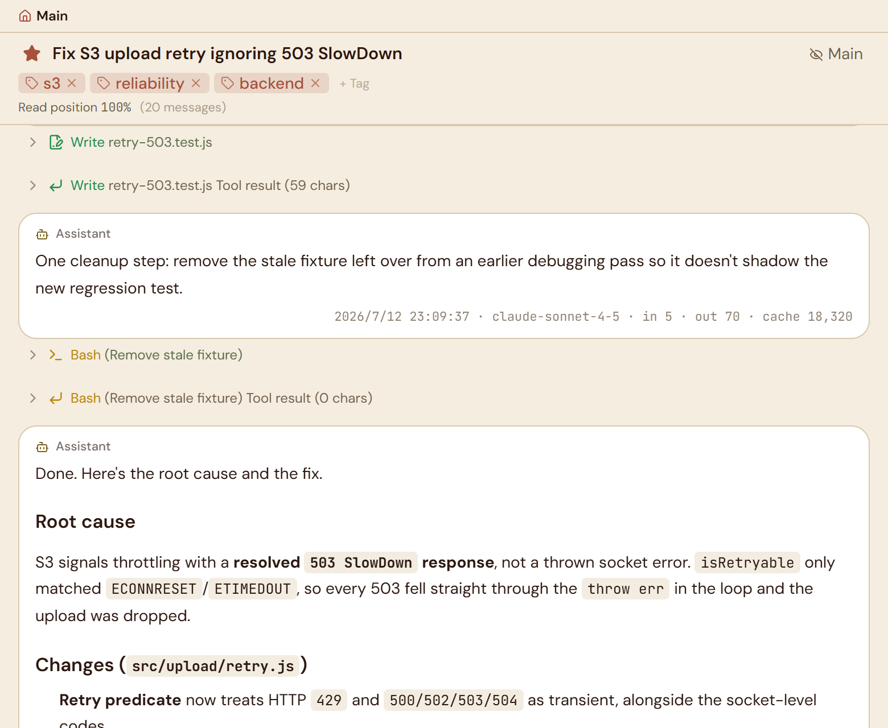
</p>

**Or read the main line only.** Focus mode strips the stream down to the actual
conversation — your prompts and the model's replies — with every tool call and
thinking block folded away. The same twenty-message session, now readable in one
pass.

<p align="center">
  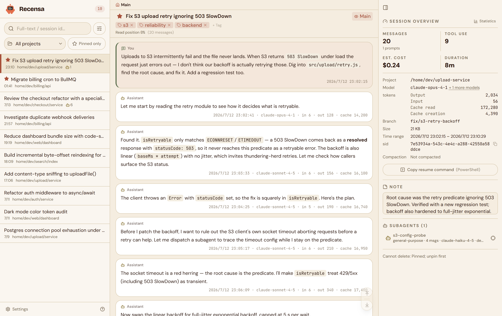
</p>

**See exactly what changed.** Every `Edit` in a session renders as a real diff —
before in red, after in green, per-file, with timestamps. Audit an agent's changes
without leaving the reader.

<p align="center">
  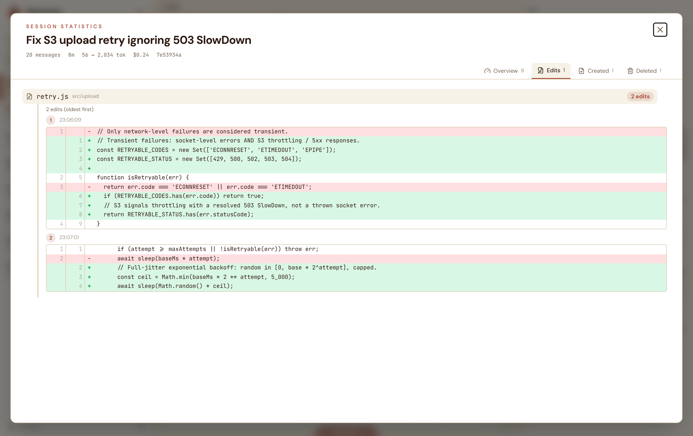
</p>

**Know what a session cost.** Per-session statistics break down tool usage, files
created / edited / deleted, model mix, token flow, and an estimated dollar cost.

<p align="center">
  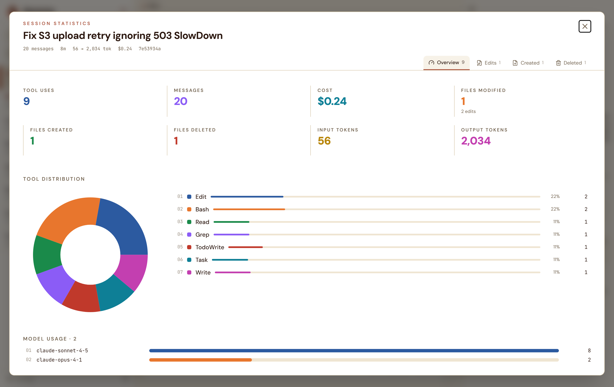
</p>

**Audit multi-agent runs.** When a session spawns subagents or teammates, Recensa
rebuilds the roster from the transcripts: every agent with its type, message count,
and model in the info panel, a crosshair that jumps to the exact call site where it
was spawned, and an "Open subagent transcript" deep-link into the agent's own
conversation — and back.

<p align="center">
  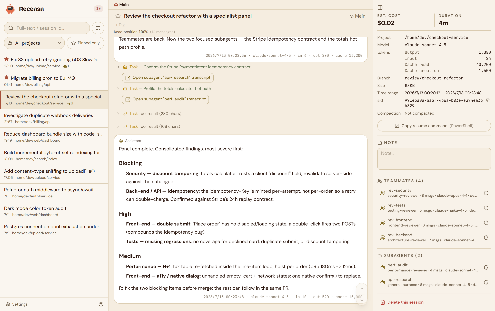
</p>

**Navigate compaction like it never happened.** When Claude Code compacts a long
session, the pre-compaction text is gone from the working context — but not from the
transcript chain. Recensa marks every compaction point in the stream, lists them in
a Compaction History panel so you can jump straight to any boundary, tracks your
read position within the current compaction segment, and can reconstruct the full
pre-compaction conversation, merged across the fork/resume chain, as a read-only
view.

<p align="center">
  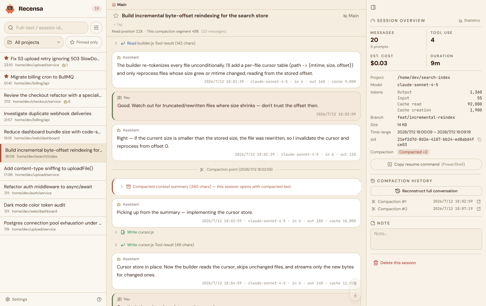
</p>

<p align="center">
  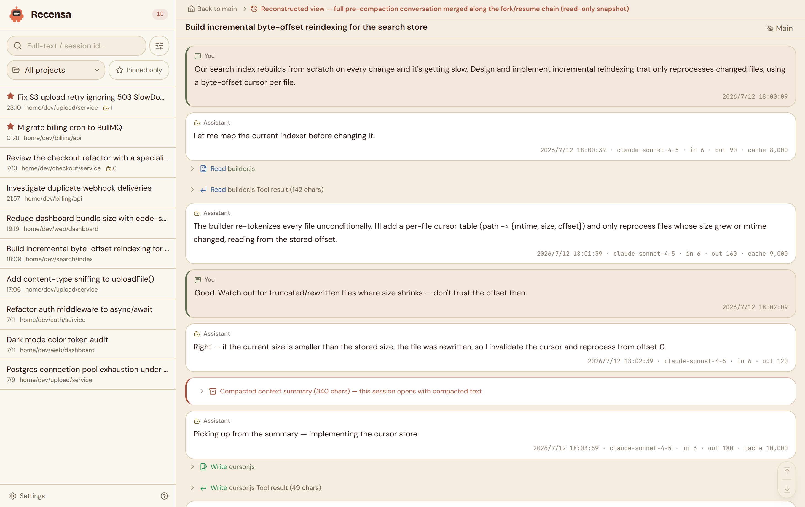
</p>

**Keep your reading state.** Pin, tag, rename, and annotate sessions. Your curation
lives in its own database (`flags.db`) that index rebuilds never touch. Live
sessions update in real time over WebSocket while Claude Code is still writing them.

<p align="center">
  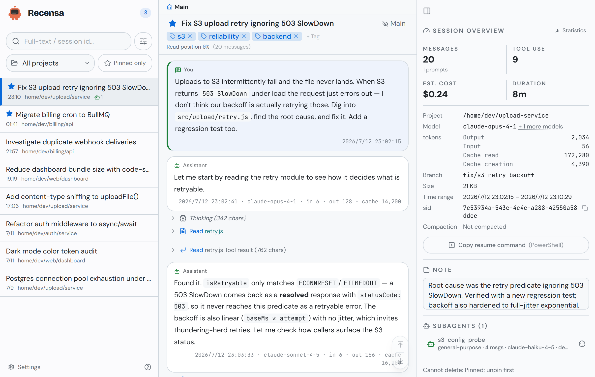
</p>

## Why Recensa

Claude Code gives you `/context`, `/resume`, and `/compact`; everything behind them
stays a black box — the raw JSONL, the token breakdown, the tool-call chains, the
point where a run looped or failed. A real run also spawns a team of subagents, and
none of that is visible in Claude Code or Claude Desktop. Recensa rebuilds the full
picture from the transcripts already on your disk:

- **Raw JSONL is unreadable.** Recensa renders it as a conversation you can follow.
- **The resume picker only shows the last few.** Full-text search covers all of them.
- **Noise buries the signal.** God-view folds thousands of tool calls into landmark
  rows and keeps the main line readable.
- **You can't tell what a run cost.** Stats break down tools, files, models, tokens.
- **Fork and resume chains fragment history.** Recensa reconstructs the full
  pre-compaction conversation across merged transcript files.
- **One bad structural edit can brick a transcript** (a permanent API 400). Recensa
  reads without side effects; structural repair is a separate, guarded tool
  ([@recensa/claude-session](https://github.com/S40911120/claude-session)).

## Non-goals

- **Not an editor.** It never rewrites transcript content. The only write path to your
  transcripts is the explicit, guarded session delete described in
  [Security and your data](#security-and-your-data).
- **Not a cloud service.** No accounts, no telemetry, no external network calls.
- **Not a Claude Code replacement.** It reads the transcripts Claude Code already
  writes to disk.
- **Not a general log viewer.** Built for Claude Code session JSONL, not arbitrary logs.

## Themes

Fourteen themes — four light, ten dark — as color-scheme homages to classic editor
palettes: Dracula, Tokyo Night, Nord, Gruvbox, One Dark Pro, Monokai, Catppuccin
(Latte and Mocha), Solarized (Light and Dark), Rosé Pine, GitHub (Light and Dark),
and the warm-light Classic. The active theme is injected server-side into the HTML,
so there is no flash of the wrong theme on load.

| | | |
|---|---|---|
| 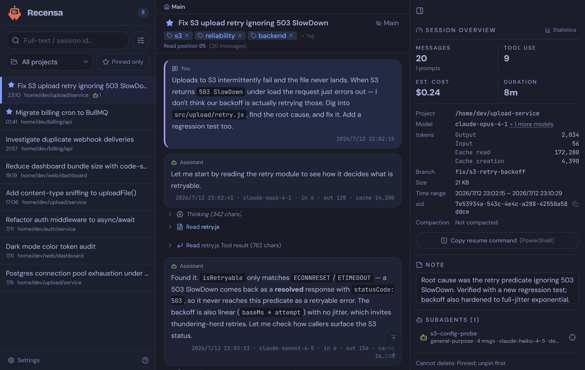 | 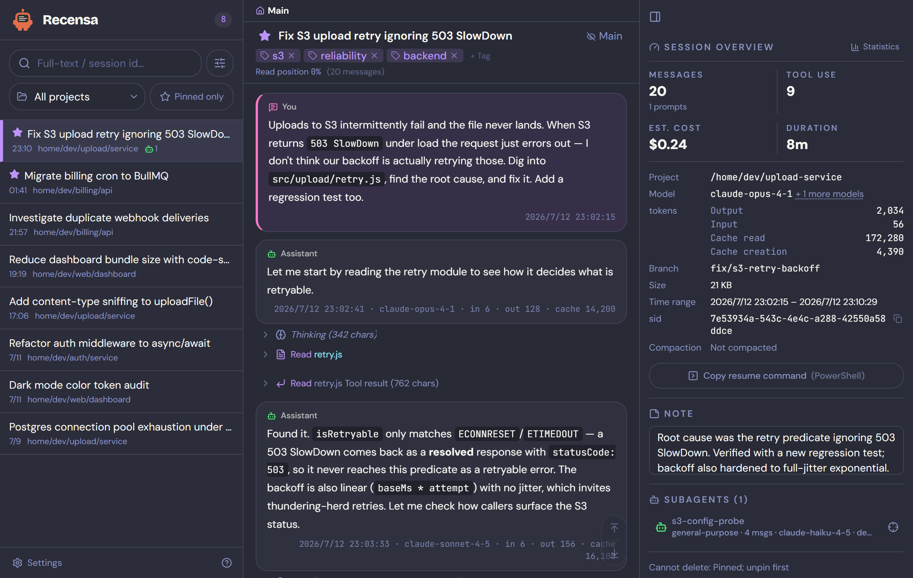 | 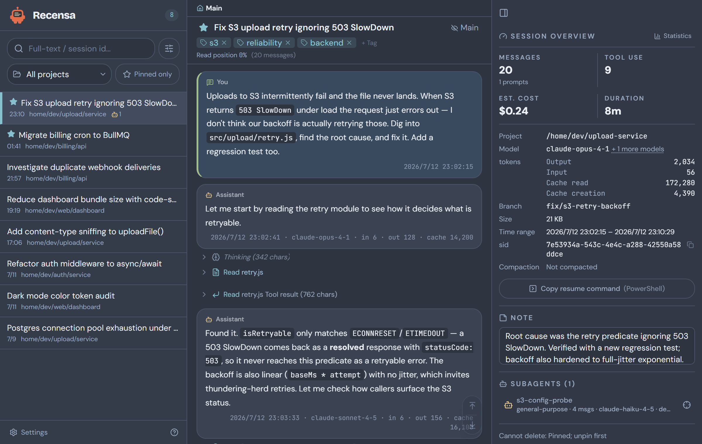 |
| Tokyo Night | Dracula | Nord |
| 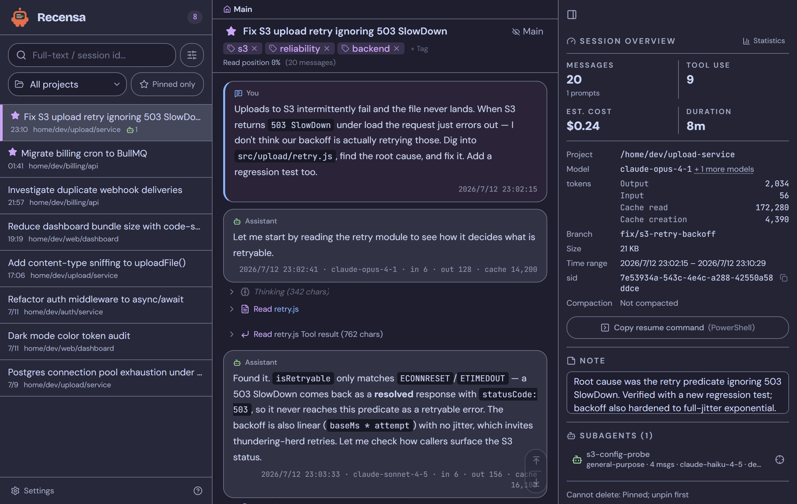 | 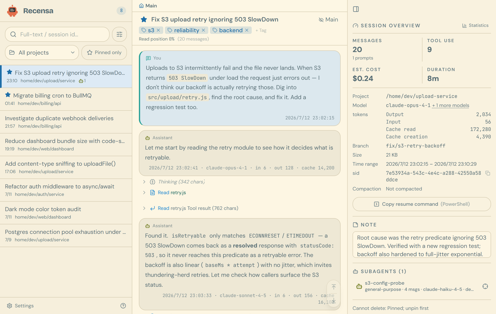 |  |
| Catppuccin Mocha | Solarized Light | GitHub Light |

## Troubleshooting

**The reader loads but the session list is empty, or the logs show an empty mount.**
`CLAUDE_HOME` did not resolve to your `.claude` directory. On Windows, Compose's
`${HOME}` fallback is usually unset under PowerShell and cmd, so the bind mount comes
up empty. Set `CLAUDE_HOME` explicitly in `.env` to an absolute path with forward
slashes (`C:/Users/you/.claude`), then rebuild with `node backend/scripts/ops.js up`.
If you used the `docker run` one-liner from Git Bash instead of PowerShell, MSYS path
rewriting is the likely culprit — rerun it from PowerShell.

**`docker compose up` fails with "port is already allocated", or `7788` never
responds.** Something else on the host already holds `7788`. Publish on a free port
by setting `RECENSA_HOST_PORT` in `.env`, then rebuild:

```
RECENSA_HOST_PORT=7799
```

The container always listens on `7788` internally; only the host-side port changes,
so open `http://localhost:7799`. Running from source instead of Docker? Set
`SESSION_VIEWER_PORT` — that is the port the server process itself binds.

**Custom hostname (optional).** To reach it at `http://sessions.local:7788`, add a
line to your hosts file (as administrator): `127.0.0.1 sessions.local`.

## Operations

All operations go through one entry point:

```bash
node backend/scripts/ops.js <command>
```

| Command | What it does |
|---------|--------------|
| `up` | Build the image and start the container (`docker compose up -d --build`) |
| `down` | Stop and remove the container |
| `restart` | Restart the running container |
| `logs` | Follow container logs |
| `status` | Container state and health |
| `smoke` | End-to-end smoke test (health / list / paging / host allowlist) |
| `check` | Type-check, lint, and unit tests, backend and frontend |
| `backfill-chain` | Recompute derived columns after a schema change (runs in the container) |
| `vacuum` | Shrink the DB file after large deletes or an FTS migration (runs in the container) |

## Architecture

<p align="center">
  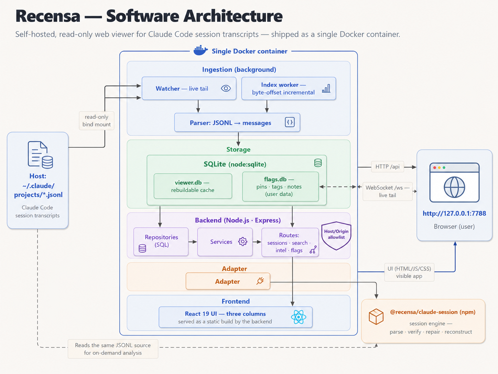
</p>

Two databases are kept deliberately separate. `viewer.db` is fully derived from the
JSONL and can be deleted and rebuilt at any time. `flags.db` holds your pins, tags,
and notes, which cannot be recomputed, so index rebuilds never touch it.

Session-JSONL parsing, verification, and reconstruction are delegated to
[@recensa/claude-session](https://www.npmjs.com/package/@recensa/claude-session), a
zero-dependency npm package that also works standalone as a CLI.

Data integrity is checked mechanically. An independent recompute of `msg_count`,
tokens, tool calls, and the model list against the raw JSONL matches the index across
sampled sessions, and the `msg_count` alignment invariant is locked by unit tests.

## Configuration

Set these two in `.env` before the first run (Compose path):

| Env var | Default | Meaning |
|---------|---------|---------|
| `CLAUDE_HOME` | *(required)* | Absolute host path to your `.claude` directory. Its `projects/` subdirectory holds the session JSONL. Bind-mounted into the container. On Windows use forward slashes (`C:/Users/you/.claude`). |
| `RECENSA_HOST_PORT` | `7788` | Host port to publish. Override only if `7788` is already taken. The container always listens on `7788` internally. |

Advanced overrides (for running from source or remote self-hosting):

| Env var | Default | Meaning |
|---------|---------|---------|
| `SESSION_VIEWER_PORT` | `7788` | HTTP/WS port the server listens on. |
| `SESSION_VIEWER_HOST` | `127.0.0.1` | Bind address. The container sets `0.0.0.0` so the published loopback port can reach it. |
| `RECENSA_PROJECTS_DIR` | `~/.claude/projects` | Root of the session JSONL tree (shared with the `recensa-session` CLI). The container sets `/data/claude/projects`. |
| `RECENSA_ALLOWED_HOSTS` | *(none)* | Extra comma-separated hostnames added to the Host/Origin allowlist. Only relevant behind your own reverse proxy (see [Security](#security-and-your-data)). |
| `RECENSA_WATCH_MODE` | *(auto)* | Watch strategy: `events` (native fs events) or `tick` (polling). Auto-selects `tick` inside Docker, where bind-mount fs events are unreliable. |

## Security and your data

Recensa is built for single-machine, local use. It ships no authentication.

- **Loopback bind is the boundary.** By default the server binds `127.0.0.1` and Docker
  Compose publishes the port to `127.0.0.1` only. On one machine, that loopback bind is
  what actually keeps the service private.
- **The Host/Origin allowlist does two jobs, and neither is a login.** It is primarily
  DNS-rebinding defense: it stops a malicious web page from using your browser to reach
  the loopback server. It additionally gates cross-origin writes (next bullet). It is
  still not access control: a non-browser client that can reach the port can forge the
  `Host` and `Origin` headers and walk past it.
- **Mutating requests require an allowlisted `Origin` (CSRF write-gate).** Every
  state-changing method (POST/PUT/DELETE/PATCH) must send an `Origin` header that is
  present and on the allowlist; GET/HEAD keep it optional. A browser always attaches
  `Origin` to a same-origin mutating fetch and cannot forge it cross-site, so another
  site open in your browser cannot drive writes against your local server. This closes
  the cross-origin write path; it does not replace auth.
- **Do not expose Recensa on `0.0.0.0` or a public interface without your own auth and a
  reverse proxy (TLS) in front of it.** Adding names via `RECENSA_ALLOWED_HOSTS` widens
  the rebinding allowlist; it does not add access control.

Your transcripts:

- **Reading never writes.** The indexer, parser, and reconstruction paths only read your
  JSONL.
- **One write path exists: deleting a session.** `DELETE /api/session/:id` physically
  removes the session's JSONL file and its subagents directory from disk. This is
  irreversible. It is guarded: pinned sessions, sessions that belong to a fork/resume
  chain, and individual subagents are all refused. Nothing else writes to your
  transcripts.
- **Your curation is safe.** Pins, tags, notes, and titles live in a separate `flags.db`
  that index rebuilds never touch. The `viewer.db` index is a disposable cache.

No secrets, no telemetry, no external network calls.

## Uninstall

Your pins, tags, notes, and titles live in `flags.db`, inside the Docker named volume
`recensa-data`. That data is not derived from the transcripts and **cannot be
recomputed**, so back it up before removing anything you want to keep:

```bash
# with the container still present, copy flags.db out of the volume
docker cp recensa:/app/backend/data/flags.db ./flags.db.backup
```

Then stop and remove the container, and optionally the image:

```bash
node backend/scripts/ops.js down        # stop and remove the container
docker image rm s40911120/recensa       # optional: drop the pulled image
```

`down` leaves the `recensa-data` volume in place, so a later rebuild keeps your
curation. **`docker compose down -v` also deletes that volume — which destroys
`flags.db` permanently.** The `viewer.db` index in the same volume is a disposable
cache that rebuilds from your JSONL, so losing it only costs the next reindex. Your
transcripts under `~/.claude` are never touched by uninstalling.

## Contributing

Contributions are welcome. To get a dev environment running:

```bash
docker compose up -d --build          # build and start the container
node backend/scripts/ops.js check     # type-check, lint, and unit tests (must pass)
```

The container serves the built frontend and runs the server; rebuild with
`node backend/scripts/ops.js up` after changes. Keep pull requests focused, follow the
existing [Conventional Commits](https://www.conventionalcommits.org/) style, and make
sure `ops.js check` passes before opening a PR. See [CONTRIBUTING.md](./CONTRIBUTING.md)
for details.

## License

MIT. See [LICENSE](./LICENSE). Author: Justin Chen.
